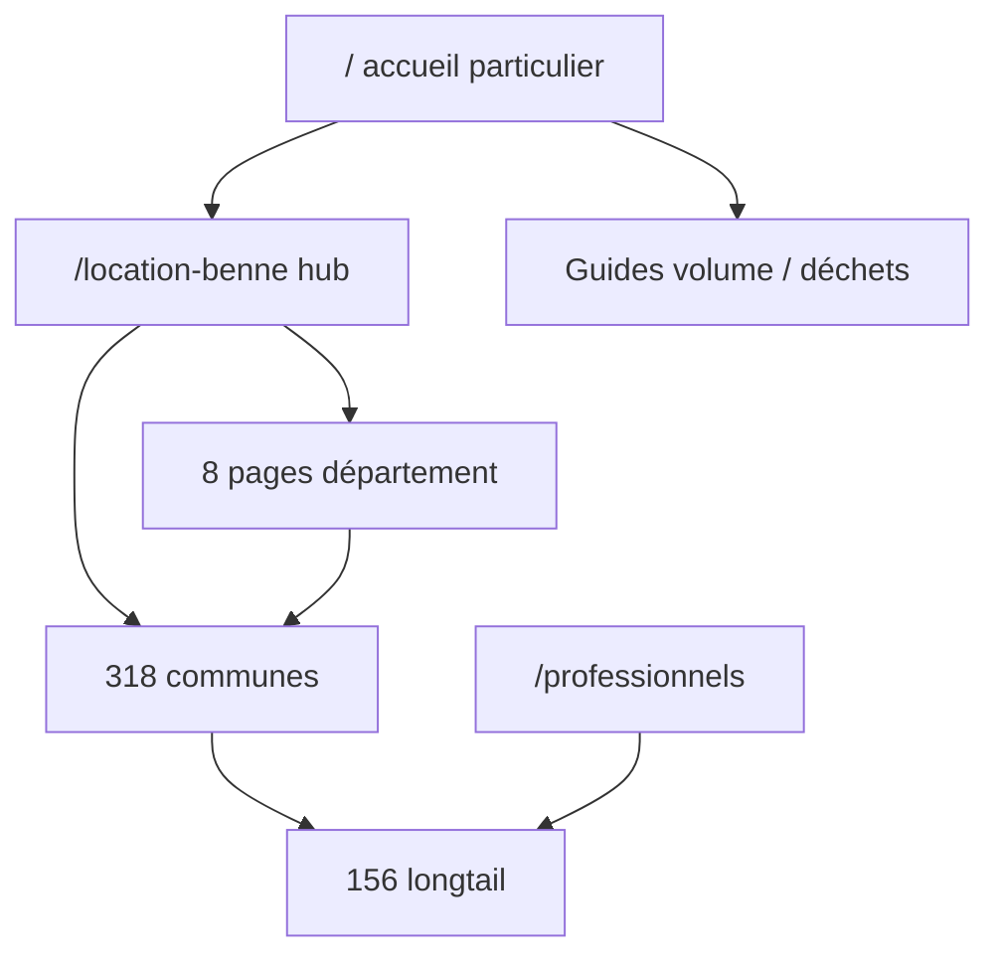

# Décisions URL SEO — par famille

**Inventaire détaillé :** [`seo-url-inventory.csv`](./seo-url-inventory.csv) (491 URLs : 9 statiques + 482 locales).  
**Ce document ne réécrit pas** les 318 textes ville : il fixe le cadre de décision et la suite du chantier.

## Travail technique déjà commité (indépendant de la GSC)

| Sujet | Commit | Détail |
|-------|--------|--------|
| Sitemap sans `lastMod` global trompeur | `b44de8c` | `app/sitemap.ts` |
| `/pro` hors sitemap | `b44de8c` | Toujours indexable, pas de `noindex` |
| JSON-LD FAQ / ratings / description | `b44de8c` | `components/seo/vitrine-json-ld.tsx` |
| Statut détaillé | — | [`chantier-seo-statut-technique.md`](./chantier-seo-statut-technique.md) |

**Publication prod :** vérifier déploiement avant de considérer ces points comme live (cf. statut technique).

---

## Exports Google Search Console manquants (liste unique)

À fournir **avant** toute fusion canonique massive ou dé-priorisation de centaines de URLs ville :

1. **Export performances pages** (16 mois ou max disponible) : colonnes URL, clics, impressions, CTR, position moyenne — filtre préfixe `https://core-environnement.fr/location-benne/`
2. **Rapport couverture / indexation** : URLs valides, exclues, « explorées non indexées », « duplicate sans canonical »
3. **Rapport **Sitemaps**** : URLs envoyées vs indexées (comparer à la version post-`b44de8c` sans `/pro`)
4. **Requêtes + pages** (croisement) : top requêtes « location benne + géo » et page principale associée (détection cannibalisation ville ↔ dept ↔ longtail)
5. **Inspection d’URL** (échantillon) : 1 URL par famille (home, hub, guide volume, dept 77, ville indexée, longtail gravats, `/professionnels`, `/pro`)
6. **Données **Core Web Vitals**** au niveau URL ou groupe (home + 3 pages locales à fort trafic si trafic existe)

Tant que ces exports manquent, les colonnes `gsc_note` de l’inventaire restent sur **« statut GSC à importer »**.

---

## Décisions par famille

### `home` (1 URL : `/`)

| | |
|---|---|
| **Décision** | Améliorer copy conversion (P0), pas de refonte URL |
| **Intentions qui se chevauchent** | Requêtes génériques « location benne IDF » vs hub `/location-benne` vs pages dept |
| **Rationale** | Page la plus forte pour la conversion particulier ; meta et JSON-LD déjà alignés sur FAQ courte (`faqSource=particulier` depuis `b44de8c`) |
| **Quand la GSC arrive** | Mesurer part des impressions « sans geo » ; si le hub capte le clic, renforcer le maillage home → hub sans fusionner les URLs |

### `hub` (1 URL : `/location-benne`)

| | |
|---|---|
| **Décision** | Améliorer intro + maillage (P1) |
| **Chevauchements** | Hub vs 8 pages dept vs 318 villes sur les requêtes « benne + commune » |
| **Rationale** | Pilier de découverte géographique ; JSON-LD `particulier` cohérent avec FAQ affichée |
| **Avec GSC** | Identifier villes à fort trafic pour liens hub prioritaires ; ne pas noindex le hub si les villes cannibalisent : ajuster ancres et H1 locaux d’abord |

### `guide` (2 URLs : volume, déchets acceptés)

| | |
|---|---|
| **Décision** | Enrichir contenu informationnel (P1) |
| **Chevauchements** | Guides vs FAQ particulier vs longtail « gravats / volume » |
| **Rationale** | `faqSource=none` en JSON-LD (pas de FAQ schema sans FAQ visible) — fait en `b44de8c` |
| **Avec GSC** | Si une longtail surperforme un guide, croiser contenu (encarts) plutôt que redirect immédiat |

### `dept` (8 URLs : 75, 77, 78, 91, 92, 93, 94, 95)

| | |
|---|---|
| **Décision** | Conserver, enrichir unicité (P1) |
| **Chevauchements** | Dept vs ville du même département (ex. 77 vs Meaux) |
| **Rationale** | Pages piliers maillage ; priorité SEO locale avant dilution dans 318 villes |
| **Avec GSC** | Fusion **ville → dept** uniquement si GSC montre 0 clic long terme + contenu strictement duplicate ; sinon enrichir la ville gagnante |

### `ville` (318 URLs)

| | |
|---|---|
| **Décision** | Améliorer progressivement (P2), **pas** de réécriture globale des textes dans ce chantier |
| **Chevauchements** | Ville vs ville voisine vs longtail `professionnel-*` vs dept |
| **Rationale** | Risque thin duplicate ; contenu actuel template + `vitrine-city-guide` |
| **Avec GSC** | Liste prioritaire : top 30 URLs par impressions ; traiter d’abord celles avec impressions > 0 et position > 10 ; laisser les URLs sans impressions sans action urgente |

### `longtail` (156 URLs)

| | |
|---|---|
| **Décision** | Améliorer ou fusionner **si** la GSC le justifie (P2) |
| **Chevauchements** | Longtail intention déchet/volume vs guides vs ville |
| **Rationale** | Capture intentions précises (gravats, enlèvement, pro par ville) |
| **Avec GSC** | Regrouper les longtails sous-performants vers parent dept ou guide si même intention et 0 clic 6 mois |

### `pro` (2 URLs : `/professionnels`, `/pro`)

| | |
|---|---|
| **Décision** | Vitrine `/professionnels` : améliorer copy (hors composants visuels) ; `/pro` : hors sitemap (P1) |
| **Chevauchements** | `/professionnels` vs longtails `professionnel-*` |
| **Rationale** | `/pro` = onboarding compte, pas landing SEO ; sitemap allégé dans `b44de8c` |
| **Avec GSC** | Si `/pro` reçoit des impressions organiques, optimiser title on-page sans le remettre au sitemap tant que l’intention est « créer un compte » |

### `legal` (3 URLs : CGV, mentions, confidentialité)

| | |
|---|---|
| **Décision** | Conserver (P3) |
| **Avec GSC** | Aucune action sauf erreurs d’indexation |

---

## Intention overlapping (schéma)

**Règle d’arbitrage :** tant que la GSC manque, **ne pas** fusionner ni désindexer des villes ; prioriser copy P0/P1 (home, hub, guides) et déploiement des correctifs sitemap/JSON-LD.

---

## Lien avec l’inventaire CSV

Colonnes utiles : `family`, `decision_proposal`, `priority`, `gsc_note`, `rationale`.  
Regénération : `npx tsx scripts/generate-seo-url-inventory.ts` (met à jour le CSV sans toucher aux pages locales).

*Dernière mise à jour : 7 novembre 2026.*
